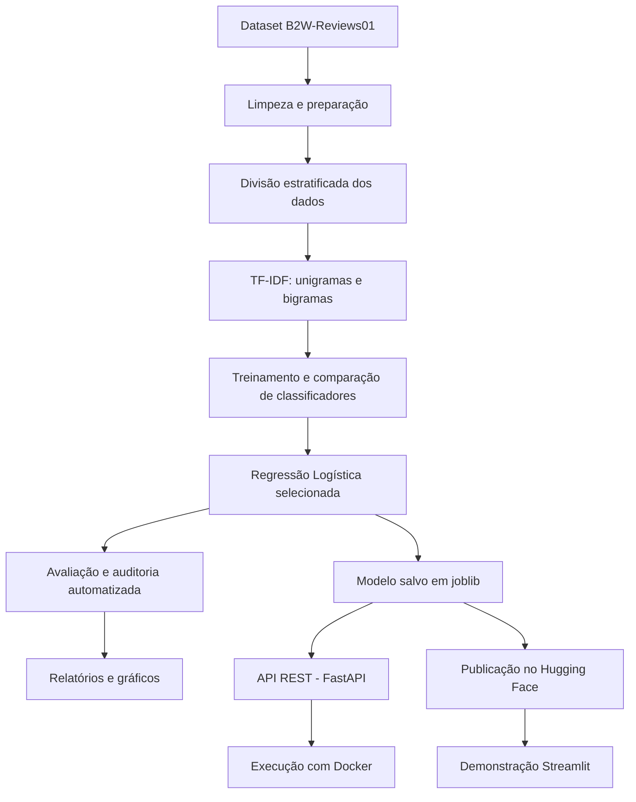
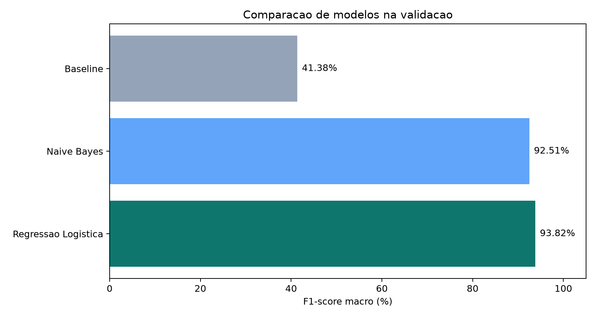
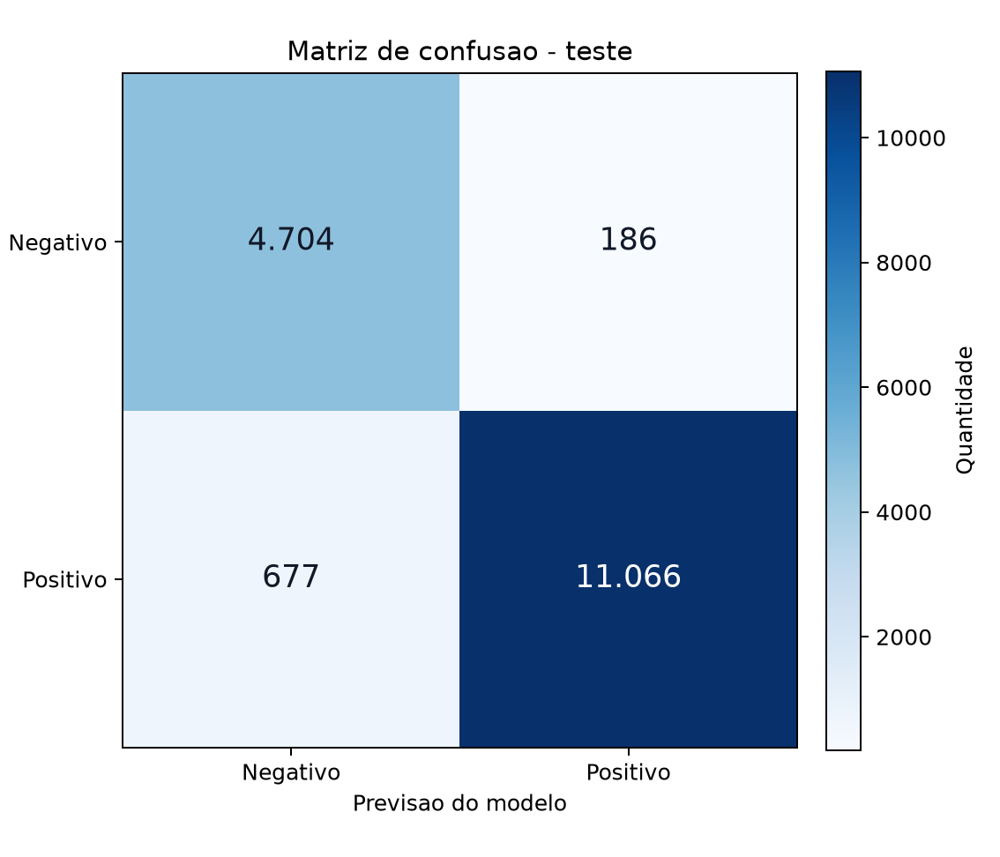

# SignalReview ML

**Classificação de sentimentos em português com Machine Learning, NLP e uma demonstração web interativa.**

O **SignalReview ML** é um projeto autoral de Machine Learning supervisionado que classifica avaliações de produtos como **positivas** ou **negativas**.

O pipeline contempla preparação dos dados, vetorização TF-IDF, comparação de classificadores, avaliação de desempenho, auditoria automatizada e inferência via API REST.

O modelo está publicado no Hugging Face e pode ser testado diretamente pelo navegador através de uma interface Streamlit.

## 🚀 Experimente o projeto

| Recurso | Link | Descrição |
|---|---|---|
| **Demonstração online** | **[Testar o SignalReview ML](https://signalreview-ml-demo.streamlit.app/)** | Classificar avaliações diretamente pelo navegador |
| **Modelo treinado** | [Hugging Face](https://huggingface.co/SabrinaVV/signalreview-ml) | Modelo, métricas e Model Card |
| **Código-fonte** | [GitHub](https://github.com/SabrinaVVascon/signalreview-ml) | Implementação completa e documentação |

> **Para recrutadores:** a demonstração online é a maneira mais rápida de experimentar o projeto. Não é necessário instalar Python, Docker ou qualquer outra dependência.

## 📊 Resultados em destaque

| Indicador | Resultado |
|---|---:|
| Avaliações utilizadas após a preparação | **110.882** |
| Modelo selecionado | **Regressão Logística** |
| Acurácia no conjunto de teste | **94,81%** |
| Precision macro | **92,88%** |
| Recall macro | **95,22%** |
| F1-score macro | **93,92%** |
| Avaliações de teste | 16.633 |
| Classificações corretas | 15.770 |
| Divergências | 863 |

**Interpretação:** as métricas representam a concordância entre as previsões e os rótulos aproximados derivados das estrelas atribuídas pelos consumidores.

Os resultados não representam uma avaliação com anotações humanas independentes nem garantem o mesmo desempenho em outros contextos.

## 🧰 Tecnologias utilizadas

### Machine Learning e NLP

- Python 3.12
- pandas e NumPy
- scikit-learn
- TF-IDF
- Regressão Logística
- Multinomial Naive Bayes
- Dummy Classifier

### Backend e infraestrutura

- FastAPI
- Uvicorn
- API REST
- Docker
- joblib
- Git e GitHub

### Demonstração web

- Streamlit
- Streamlit Community Cloud
- Hugging Face Hub

### Testes e avaliação

- pytest
- Matplotlib
- Accuracy, Precision, Recall e F1-score
- Matriz de confusão
- Auditoria automatizada de divergências

## 🧠 Arquitetura do projeto

O SignalReview ML implementa um pipeline supervisionado de classificação de sentimentos.



A vetorização e o classificador são armazenados em um único `Pipeline` do scikit-learn, permitindo realizar previsões diretamente a partir dos textos originais.

### Estrutura do repositório

```text
signalreview-ml/
├── app/
│   └── main.py
├── demo/
│   ├── app.py
│   └── requirements.txt
├── ml/
│   ├── download_dataset.py
│   ├── prepare_data.py
│   ├── train.py
│   ├── analyze_errors.py
│   ├── analyze_auto.py
│   └── plot_metrics.py
├── tests/
│   ├── test_api.py
│   └── test_training.py
├── data/
├── artifacts/
│   └── figures/
│       ├── comparacao_modelos.png
│       ├── matriz_confusao.png
│       └── triagem_automatica.png
├── Dockerfile
├── requirements.txt
├── requirements-api.txt
└── README.md
```

Os dados brutos, os arquivos processados e o modelo binário não são distribuídos pelo GitHub.

O modelo treinado está disponível separadamente no [Hugging Face](https://huggingface.co/SabrinaVV/signalreview-ml).

## 🗂️ Dataset e preparação

**Fonte:** [B2W-Reviews01](https://github.com/americanas-tech/b2w-reviews01), conjunto de avaliações de produtos em português.

Após o pré-processamento, foram utilizadas **110.882 avaliações**.

### Distribuição das classes

| Sentimento | Quantidade |
|---|---:|
| Positivo | 78.281 |
| Negativo | 32.601 |
| **Total** | **110.882** |

### Estratégia de rotulagem

Os rótulos foram construídos a partir das notas atribuídas pelos consumidores:

- 1 e 2 estrelas: negativo
- 3 estrelas: excluído
- 4 e 5 estrelas: positivo

O pipeline realiza limpeza dos dados, exclusão de registros inválidos e remoção de avaliações duplicadas.

As estrelas são utilizadas como rótulos aproximados, podendo existir divergências entre a nota atribuída pelo consumidor e o sentimento expresso no comentário.

### Divisão dos dados

Foi realizada uma divisão estratificada:

| Conjunto | Quantidade | Proporção |
|---|---:|---:|
| Treinamento | 77.617 | 70% |
| Validação | 16.632 | 15% |
| Teste | 16.633 | 15% |

O processo utiliza `random_state=42` para permitir a reprodução da divisão.

Os modelos são comparados no conjunto de validação. O modelo selecionado é posteriormente reajustado utilizando treino e validação, mantendo o conjunto de teste separado.

## 📈 Avaliação dos modelos

### Comparação dos classificadores

Foram treinados e comparados três classificadores supervisionados ou de referência:

| Modelo | F1-score macro na validação |
|---|---:|
| Dummy Classifier | 41,38% |
| Multinomial Naive Bayes | 92,51% |
| **Regressão Logística** | **93,82%** |

A Regressão Logística foi selecionada por apresentar o melhor F1-score macro na validação.



### Avaliação no conjunto de teste

| Métrica | Resultado |
|---|---:|
| Accuracy | 94,81% |
| Precision macro | 92,88% |
| Recall macro | 95,22% |
| F1-score macro | 93,92% |

### Matriz de confusão

| Real / Previsto | Negativo | Positivo |
|---|---:|---:|
| Negativo | 4.704 | 186 |
| Positivo | 677 | 11.066 |



Foram registradas 15.770 correspondências e 863 divergências em relação aos rótulos derivados das estrelas.

## 🔍 Auditoria automatizada

Além das métricas tradicionais, o projeto implementa um processo automatizado para investigar divergências.

O sistema utiliza dois classificadores:

- **Modelo principal:** Regressão Logística.
- **Modelo auxiliar:** Multinomial Naive Bayes.

O objetivo é identificar casos em que as previsões dos modelos divergem dos rótulos associados às estrelas.

### Resultados da auditoria

| Categoria de triagem | Quantidade |
|---|---:|
| Modelos concordam entre si e discordam das estrelas | 502 |
| Modelos discordam entre si | 253 |
| Modelos concordam entre si e discordam das estrelas, com pontuações ≥ 90% | 108 |
| **Total de divergências** | **863** |

Em 610 casos, os dois modelos concordaram entre si, mas discordaram do rótulo derivado das estrelas.

Desses casos, 108 apresentaram pontuações de pelo menos 90% em ambos os classificadores.

Esses resultados representam indícios para investigação, não a confirmação de erros nos rótulos.

Ambos os modelos foram treinados utilizando rótulos derivados das estrelas e podem cometer erros semelhantes.


### Arquivos gerados

Os scripts geram relatórios locais na pasta `artifacts/`, incluindo:

- `erros_teste.csv`
- `auditoria_automatica.csv`
- `auditoria_resumo.json`
- `relatorio_auditoria.md`

Os relatórios que contêm textos de consumidores não são incluídos no repositório público.

## 🌐 Demonstração pública com Streamlit

**[Acessar demonstração online](https://signalreview-ml-demo.streamlit.app/)**

O projeto possui uma interface pública desenvolvida com Streamlit.

A aplicação permite:

1. Digitar uma avaliação de produto em português.
2. Enviar o texto para classificação.
3. Visualizar o sentimento previsto.
4. Consultar as pontuações estimadas para cada classe.

A aplicação carrega o modelo treinado diretamente do Hugging Face.

A demonstração foi publicada no Streamlit Community Cloud e testada com sucesso em uma janela anônima de outro navegador.

### Executar o Streamlit localmente

Após configurar o ambiente Python, instale as dependências da demonstração:

```powershell
.\.venv\Scripts\python.exe -m pip install -r demo/requirements.txt
```

Execute:

```powershell
.\.venv\Scripts\python.exe -m streamlit run demo/app.py
```

O Streamlit disponibilizará a interface local, normalmente em:

`http://localhost:8501`

**Atenção:** esse endereço funciona somente no computador em que o Streamlit estiver executando.

Para acessar a aplicação pública, utilize:

https://signalreview-ml-demo.streamlit.app/

## 🛠️ Instalação e reprodução do treinamento

### Pré-requisitos

- Python 3.12
- Git
- Acesso à internet para baixar o dataset
- VS Code ou outro editor de código

### 1. Clonar o repositório

```bash
git clone https://github.com/SabrinaVVascon/signalreview-ml.git
cd signalreview-ml
```

### 2. Criar o ambiente virtual

No Windows, utilizando PowerShell:

```powershell
python -m venv .venv
```

### 3. Instalar as dependências

```powershell
.\.venv\Scripts\python.exe -m pip install -r requirements.txt
```

Caso o ambiente tenha sido criado pelo `uv` sem o `pip`, também é possível instalar as dependências utilizando:

```powershell
uv pip install --python .venv/Scripts/python.exe -r requirements.txt
```

### 4. Baixar o dataset

```powershell
.\.venv\Scripts\python.exe -m ml.download_dataset
```

### 5. Preparar os dados

```powershell
.\.venv\Scripts\python.exe -m ml.prepare_data
```

### 6. Treinar os modelos

```powershell
.\.venv\Scripts\python.exe -m ml.train
```

O treinamento realiza a comparação dos classificadores e seleciona o modelo com melhor F1-score macro na validação.

### Arquivos produzidos

Após o treinamento:

- `artifacts/model.joblib` — pipeline de vetorização e classificação.
- `artifacts/metrics.json` — métricas e informações do treinamento.
- `data/processed/reviews.csv` — avaliações preparadas.

Esses arquivos são gerados localmente.

Os resultados podem variar caso os dados, as dependências ou o código sejam modificados.

## 🧪 Testes e análises automatizadas

O projeto utiliza pytest para validar partes do treinamento e da API.

### Executar os testes

```powershell
.\.venv\Scripts\python.exe -m pytest -q
```

Resultado da última execução local:

```text
4 passed, 1 warning in 1.72s
```

O aviso está relacionado à depreciação de uma integração utilizada por uma dependência de testes.

### Analisar divergências

```powershell
.\.venv\Scripts\python.exe -m ml.analyze_errors
```

### Executar a auditoria automática

```powershell
.\.venv\Scripts\python.exe -m ml.analyze_auto
```

### Gerar gráficos

```powershell
.\.venv\Scripts\python.exe -m ml.plot_metrics
```

Os gráficos serão gerados no diretório:

`artifacts/figures/`

A ampliação dos testes de integração e reprodução permanece como melhoria planejada.

## 🔌 API REST com FastAPI

O SignalReview ML disponibiliza uma API REST para classificação de sentimentos e consulta das informações do modelo.

### Endpoints

| Método | Endpoint | Função |
|---|---|---|
| GET | `/health` | Verificar o estado da API e do modelo |
| GET | `/model-info` | Consultar informações e métricas |
| POST | `/predict` | Classificar o sentimento de um texto |

### Executar a API localmente

Antes de iniciar, é necessário possuir os arquivos:

- `artifacts/model.joblib`
- `artifacts/metrics.json`

Esses arquivos são produzidos pelo treinamento.

Na raiz do projeto, execute:

```powershell
.\.venv\Scripts\python.exe -m uvicorn app.main:app --reload
```

### Documentação local da API

**Os endereços abaixo somente funcionam enquanto o servidor FastAPI estiver executando no seu computador.**

| Recurso | Endereço local |
|---|---|
| Swagger UI | `http://127.0.0.1:8000/docs` |
| Health Check | `http://127.0.0.1:8000/health` |
| Informações do modelo | `http://127.0.0.1:8000/model-info` |

Esses endereços não são públicos.

O endereço `http://127.0.0.1:8000/` pode retornar `404 Not Found`, pois não existe uma página inicial definida na raiz da API.

### Exemplo de requisição

Endpoint: `POST /predict`

```json
{
  "texto": "O produto chegou rápido e funciona perfeitamente!"
}
```

### Exemplo de resposta

```json
{
  "sentimento": "positivo",
  "confianca": 0.9997,
  "probabilidades": {
    "negativo": 0.0003,
    "positivo": 0.9997
  }
}
```

O exemplo demonstra o formato da resposta. As pontuações variam conforme o texto enviado.

## 🐳 Docker

A API também pode ser executada em um contêiner Docker.

O projeto utiliza uma imagem Python 3.12 com as dependências necessárias para executar o FastAPI e o Uvicorn.

### Arquivos de configuração

- `Dockerfile`
- `.dockerignore`
- `requirements-api.txt`

### Pré-requisitos

- Docker Desktop ou Docker Engine instalado e em execução.
- Modelo treinado em `artifacts/model.joblib`.
- Métricas salvas em `artifacts/metrics.json`.

O Dockerfile não baixa automaticamente o modelo do Hugging Face.

Por isso, os arquivos do modelo e das métricas precisam estar disponíveis localmente antes da construção da imagem.

### 1. Construir a imagem

Na raiz do projeto:

```bash
docker build -t signalreview-ml .
```

### 2. Executar o contêiner

```bash
docker run --rm -p 8001:8000 signalreview-ml
```

A porta 8001 do computador é encaminhada para a porta 8000 dentro do contêiner.

### 3. Acessar a documentação local

**Somente enquanto o contêiner estiver executando:**

| Recurso | Endereço local |
|---|---|
| Swagger UI | `http://127.0.0.1:8001/docs` |
| Health Check | `http://127.0.0.1:8001/health` |
| Informações do modelo | `http://127.0.0.1:8001/model-info` |

Esses endereços são locais e não ficam disponíveis publicamente.

### 4. Testar a classificação

Na documentação Swagger, execute:

- `GET /model-info`
- `POST /predict`

A API deverá retornar as informações do modelo e realizar a classificação das avaliações enviadas.

### Resultado da validação

A imagem Docker foi construída e executada com sucesso em ambiente Windows utilizando Docker Desktop e WSL 2.

Foram validados:

- Construção da imagem Docker.
- Inicialização do contêiner.
- Inicialização do servidor Uvicorn.
- Disponibilidade da API na porta 8001.
- Respostas HTTP 200.
- Carregamento do modelo de Regressão Logística.
- Classificação de sentimentos utilizando o modelo treinado.

**Status: Docker validado com sucesso.**

Para interromper a execução, utilize `Ctrl + C` no terminal que está executando o contêiner.

## ⚠️ Limitações e uso responsável

Apesar dos resultados obtidos, o SignalReview ML possui limitações:

- O classificador é binário e não identifica sentimentos neutros.
- Os rótulos de referência são derivados das estrelas atribuídas pelos consumidores.
- Ironia, sarcasmo e sentimentos mistos podem prejudicar as previsões.
- As probabilidades produzidas pelo modelo não passaram por calibração específica.
- Os resultados não representam garantias de acerto em outros domínios.
- O desempenho em outras plataformas não foi validado.
- A auditoria automática realiza triagem de possíveis inconsistências, não validação humana independente.
- Dois classificadores diferentes podem cometer erros semelhantes.

Arquivos `joblib` utilizam serialização baseada em pickle e devem ser carregados somente quando provenientes de fontes confiáveis.

O modelo não deve ser utilizado como única base para decisões de alto impacto.

## 📄 Dados, licença e créditos

O projeto utiliza o dataset **B2W-Reviews01**.

Fonte original:

https://github.com/americanas-tech/b2w-reviews01

O dataset foi disponibilizado sob a licença **CC BY-NC-SA 4.0**, que estabelece condições de atribuição, uso não comercial e compartilhamento pela mesma licença.

O modelo publicado no Hugging Face utiliza essa licença como escolha conservadora.

A aplicabilidade jurídica da licença dos dados aos parâmetros treinados pode exigir análise específica.

Os arquivos brutos e processados contendo avaliações dos consumidores não são distribuídos neste repositório.

O código-fonte do projeto ainda não possui uma licença própria explicitamente definida.

## ✅ Status do projeto

- [x] Configuração do ambiente Python
- [x] Ingestão e preparação dos dados
- [x] Treinamento supervisionado
- [x] Comparação de classificadores
- [x] Avaliação de desempenho
- [x] Matriz de confusão
- [x] Análise de erros
- [x] Auditoria automatizada
- [x] Geração de gráficos
- [x] API REST com FastAPI
- [x] Testes automatizados iniciais
- [x] Construção da imagem Docker
- [x] Validação da API no Docker
- [x] Publicação do código no GitHub
- [x] Publicação do modelo no Hugging Face
- [x] Criação do Model Card
- [x] Demonstração Streamlit publicada
- [x] Teste público em janela anônima
- [ ] Ampliação dos testes de integração
- [ ] Verificação de reprodução em ambiente limpo

## 🎯 Objetivo

O SignalReview ML foi desenvolvido como projeto autoral de portfólio em **Engenharia de Inteligência Artificial**, demonstrando conhecimentos práticos em:

- Machine Learning supervisionado.
- Processamento de linguagem natural.
- Preparação e vetorização de dados textuais.
- Treinamento e avaliação de classificadores.
- Investigação automatizada de divergências.
- Desenvolvimento e integração de APIs.
- Containerização com Docker.
- Publicação de modelos no Hugging Face.
- Disponibilização de aplicações de IA na web.

---

**Projeto autoral de portfólio em Engenharia de Inteligência Artificial — 2026.**
