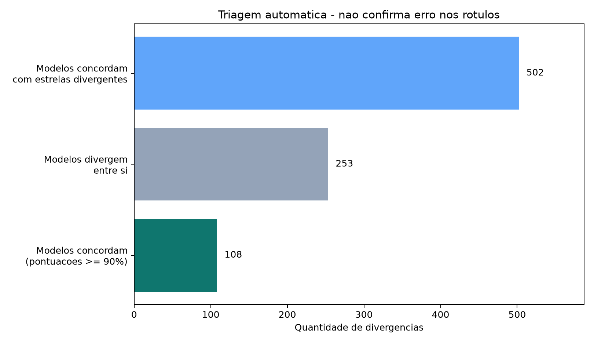

# SignalReview ML

**Classificação de sentimentos em português com Machine Learning, NLP e FastAPI.**

O SignalReview ML é um projeto de Inteligência Artificial desenvolvido para classificar automaticamente o sentimento de avaliações de produtos em português.

A aplicação implementa um pipeline completo de Machine Learning, abrangendo ingestão e preparação de dados, processamento de linguagem natural (NLP), treinamento supervisionado, comparação de classificadores, avaliação de desempenho, auditoria automatizada e disponibilização de inferência por API REST.

O projeto também utiliza Docker para permitir a execução da API em um ambiente padronizado.

## Tecnologias utilizadas

**Machine Learning e NLP**
- Python 3.12
- pandas e NumPy
- scikit-learn
- TF-IDF
- Regressão Logística
- Multinomial Naive Bayes
- Dummy Classifier

**Backend e infraestrutura**
- FastAPI
- Uvicorn
- REST API
- Docker
- Git e GitHub

**Testes e visualização**
- pytest
- Matplotlib
- joblib
- Métricas de classificação
- Matriz de confusão

## Dataset

O projeto utiliza o conjunto de dados [B2W-Reviews01](https://github.com/americanas-tech/b2w-reviews01), contendo avaliações de consumidores brasileiros.

Após o pré-processamento, foram utilizadas **110.882 avaliações**.

### Distribuição das classes

| Sentimento | Avaliações |
|---|---:|
| Positivo | 78.281 |
| Negativo | 32.601 |
| **Total** | **110.882** |

Os rótulos foram derivados das notas atribuídas pelos consumidores:

- 1 e 2 estrelas: negativo
- 3 estrelas: excluído
- 4 e 5 estrelas: positivo

O pré-processamento também remove registros incompletos, avaliações duplicadas e textos inválidos.

As estrelas são utilizadas como rótulos aproximados, podendo existir divergências entre a nota e o sentimento expresso no comentário.

## Arquitetura do projeto

O pipeline foi organizado nas seguintes etapas:

1. **Ingestão:** obtenção das avaliações em formato CSV.
2. **Preparação:** limpeza, tratamento e classificação inicial dos registros.
3. **Separação:** divisão estratificada em treino, validação e teste.
4. **Vetorização:** transformação dos textos em características numéricas utilizando TF-IDF.
5. **Treinamento:** treinamento supervisionado dos classificadores.
6. **Comparação:** avaliação dos modelos utilizando métricas de classificação.
7. **Seleção:** escolha do modelo pelo F1-score macro de validação.
8. **Avaliação final:** análise do desempenho no conjunto de teste.
9. **Persistência:** armazenamento do modelo treinado utilizando joblib.
10. **API:** disponibilização de previsões por FastAPI.
11. **Auditoria:** investigação automática das divergências entre modelos e rótulos.
12. **Visualização:** geração de gráficos e relatórios de avaliação.
13. **Containerização:** execução da API utilizando Docker.

### Fluxo de funcionamento

```text
Dataset B2W-Reviews01
         |
         v
Limpeza e preparação
         |
         v
Treino / Validação / Teste
         |
         v
Vetorização TF-IDF
         |
         v
Treinamento dos classificadores
         |
         v
Comparação e seleção do modelo
         |
         v
Regressão Logística
         |
         +------> Avaliação e auditoria
         |
         v
Modelo salvo (.joblib)
         |
         v
API REST - FastAPI
         |
         v
Classificação de sentimentos
```

## Resultados do Machine Learning

O modelo selecionado foi a **Regressão Logística**, por apresentar o melhor F1-score macro na etapa de validação.

### Métricas no conjunto de teste

| Métrica | Resultado |
|---|---:|
| Acurácia | 94,81% |
| Precision macro | 92,88% |
| Recall macro | 95,22% |
| F1-score macro | 93,92% |
| Avaliações de teste | 16.633 |
| Classificações corretas | 15.770 |
| Classificações divergentes | 863 |

Os resultados representam o desempenho em relação aos rótulos derivados das estrelas, não uma medição direta de concordância com anotações humanas independentes.

### Comparação dos classificadores

F1-score macro obtido no conjunto de validação:

| Modelo | F1-score macro |
|---|---:|
| Dummy Baseline | 41,38% |
| Multinomial Naive Bayes | 92,51% |
| Regressão Logística | 93,82% |

### Gráfico comparativo


### Matriz de confusão


A matriz de confusão permite identificar os acertos e as divergências de classificação em cada classe.

## Auditoria automática de classificações

Foi desenvolvido um processo de auditoria automatizada utilizando dois classificadores:

- **Modelo principal:** Regressão Logística.
- **Modelo auxiliar:** Multinomial Naive Bayes.

O objetivo é identificar possíveis inconsistências entre o sentimento escrito e as estrelas atribuídas pelos consumidores.

### Resultados da auditoria

Foram analisadas as 863 divergências identificadas no conjunto de teste.

| Categoria | Quantidade |
|---|---:|
| Possível inconsistência entre texto e estrelas | 502 |
| Modelos divergentes entre si | 253 |
| Possível inconsistência com pontuações elevadas | 108 |
| **Total** | **863** |

Em 610 casos, os dois classificadores concordaram entre si, mas discordaram do rótulo derivado das estrelas.

Desses casos, 108 apresentaram pontuações iguais ou superiores a 90% nos dois modelos.

Esses resultados são utilizados para triagem e investigação automática. A concordância entre dois classificadores não comprova que as estrelas estão incorretas.

As pontuações dos modelos também não devem ser interpretadas como probabilidades calibradas de acerto.

### Visualização da auditoria



A auditoria gera automaticamente:

- `auditoria_automatica.csv`
- `auditoria_resumo.json`
- `relatorio_auditoria.md`

Os relatórios locais contêm informações da análise e não precisam ser enviados ao repositório público.

## Instalação local

### Pré-requisitos

- Python 3.12
- Git
- Editor de código, como VS Code

### Clonar o repositório

Após a publicação no GitHub:

```bash
git clone https://github.com/SEU-USUARIO/signalreview-ml.git
cd signalreview-ml
```

Substitua `SEU-USUARIO` pelo usuário real do GitHub.

### Criar o ambiente virtual

No Windows:

```powershell
python -m venv .venv
```

### Instalar dependências

```powershell
.\.venv\Scripts\python.exe -m pip install -r requirements.txt
```

Os comandos seguintes pressupõem o ambiente virtual ativado. Também é possível utilizar diretamente o executável Python da pasta `.venv`.

## Preparação e treinamento

Execute os comandos na raiz do projeto.

### 1. Download do dataset

```powershell
python -m ml.download_dataset
```

### 2. Preparação das avaliações

```powershell
python -m ml.prepare_data
```

### 3. Treinamento dos modelos

```powershell
python -m ml.train
```

O treinamento compara os classificadores e seleciona o modelo com melhor F1-score macro de validação.

O modelo selecionado será armazenado em:

```text
artifacts/model.joblib
```

As métricas e informações do treinamento serão salvas em:

```text
artifacts/metrics.json
```

## API REST com FastAPI

A aplicação disponibiliza uma API para realizar previsões de sentimentos.

### Iniciar a API localmente

```powershell
python -m uvicorn app.main:app --reload
```

Documentação interativa:

http://127.0.0.1:8000/docs

### Endpoints

| Método | Endpoint | Descrição |
|---|---|---|
| GET | `/model-info` | Informações e métricas do modelo |
| POST | `/predict` | Classificação de sentimentos |

### Exemplo de requisição

Endpoint: `POST /predict`

```json
{
  "texto": "O produto chegou rápido e funciona perfeitamente!"
}
```

### Exemplo de resposta

```json
{
  "sentimento": "positivo",
  "confianca": 0.9997,
  "probabilidades": {
    "negativo": 0.0003,
    "positivo": 0.9997
  }
}
```

O exemplo apresenta o formato da resposta da API. As pontuações variam conforme o texto analisado.

A API recebe uma avaliação em linguagem natural e retorna o sentimento previsto e as probabilidades estimadas das classes.

## Análise automatizada

O projeto contém scripts para investigar erros e gerar relatórios.

### Análise dos erros

```powershell
python -m ml.analyze_errors
```

Identifica divergências entre as previsões do modelo e os rótulos de referência.

### Auditoria automática

```powershell
python -m ml.analyze_auto
```

Treina um classificador auxiliar e compara as previsões dos modelos.

### Geração dos gráficos

```powershell
python -m ml.plot_metrics
```

Os gráficos são armazenados em:

```text
artifacts/figures/
```

Arquivos gerados:

- `comparacao_modelos.png`
- `matriz_confusao.png`
- `triagem_automatica.png`

## Testes automatizados

O projeto utiliza pytest para validação do treinamento e da API.

Para executar os testes:

```powershell
python -m pytest -q
```

### Resultado da última execução local

```text
4 passed, 1 warning in 1.72s
```

Os quatro testes existentes passaram.

O aviso identificado está relacionado à depreciação de uma integração de dependências utilizada pelo cliente de testes.

A ampliação da cobertura de testes permanece como melhoria planejada.

## Docker

A API também pode ser executada em um contêiner Docker.

A imagem utiliza Python 3.12 e instala as dependências necessárias para executar a aplicação.

A configuração utiliza os arquivos:

- `Dockerfile`
- `.dockerignore`
- `requirements-api.txt`

### Pré-requisitos

- Docker Desktop ou Docker Engine
- Modelo previamente treinado em `artifacts/model.joblib`
- Métricas em `artifacts/metrics.json`

O modelo treinado não é incluído no repositório Git, portanto deve estar disponível antes da construção da imagem.

### 1. Construir a imagem

Na raiz do projeto:

```bash
docker build -t signalreview-ml .
```

### 2. Executar o contêiner

```bash
docker run --rm -p 8001:8000 signalreview-ml
```

A porta 8001 do computador é direcionada para a porta 8000 do contêiner.

### 3. Acessar a documentação

http://127.0.0.1:8001/docs

### 4. Testar o modelo

Na documentação interativa, execute:

- `GET /model-info`
- `POST /predict`

A API deverá retornar as informações do modelo e realizar a classificação das avaliações enviadas.

### Resultado da validação

A imagem Docker foi construída e executada com sucesso em ambiente Windows utilizando Docker Desktop e WSL 2.

Foram confirmados:

- Inicialização do contêiner
- Inicialização do servidor Uvicorn
- Disponibilidade da API na porta 8001
- Retorno HTTP 200 nas requisições testadas
- Carregamento do modelo de Regressão Logística
- Classificação de sentimentos utilizando o modelo treinado

**Status: Docker validado com sucesso.**

## Limitações do projeto

Apesar dos resultados obtidos, o sistema possui limitações importantes:

- As classificações de referência são derivadas de estrelas, não de anotação humana independente.
- A classificação é binária e não identifica sentimentos neutros.
- Comentários irônicos ou ambíguos podem gerar previsões incorretas.
- As probabilidades do modelo não passaram por calibração específica.
- Classificadores diferentes podem cometer erros semelhantes.
- O desempenho em outras plataformas ou domínios ainda não foi avaliado.
- A auditoria automática identifica indícios de inconsistência, não erros comprovados nos dados.

Essas limitações são consideradas na interpretação das métricas e nos relatórios do projeto.

## Dados e licenciamento

Dataset original: [B2W-Reviews01](https://github.com/americanas-tech/b2w-reviews01).

A utilização dos dados deve respeitar as condições de atribuição e uso não comercial estabelecidas pela fonte original.

O repositório não inclui os arquivos brutos ou processados contendo as avaliações dos consumidores.

Os dados utilizados podem ser obtidos por meio do script de download, respeitando os termos do dataset.

A licença do código do projeto será definida separadamente.

## Status de desenvolvimento

- [x] Configuração do ambiente Python
- [x] Ingestão e preparação dos dados
- [x] Treinamento supervisionado
- [x] Comparação de classificadores
- [x] Avaliação de desempenho
- [x] API REST com FastAPI
- [x] Testes automatizados iniciais
- [x] Análise de erros
- [x] Auditoria automatizada
- [x] Geração de gráficos
- [x] Construção da imagem Docker
- [x] Validação da API no Docker
- [ ] Publicação do código no GitHub
- [ ] Publicação do modelo no Hugging Face
- [ ] Criação do model card
- [ ] Ampliação dos testes de integração e reprodução

## Objetivo

O SignalReview ML foi desenvolvido como projeto autoral de portfólio em Engenharia de Inteligência Artificial, com foco na aplicação prática de Machine Learning supervisionado, processamento de linguagem natural, engenharia de software e disponibilização de modelos por API.
